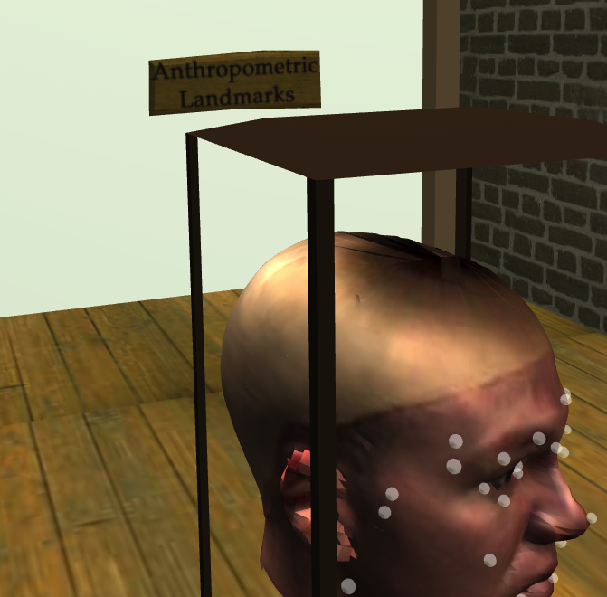
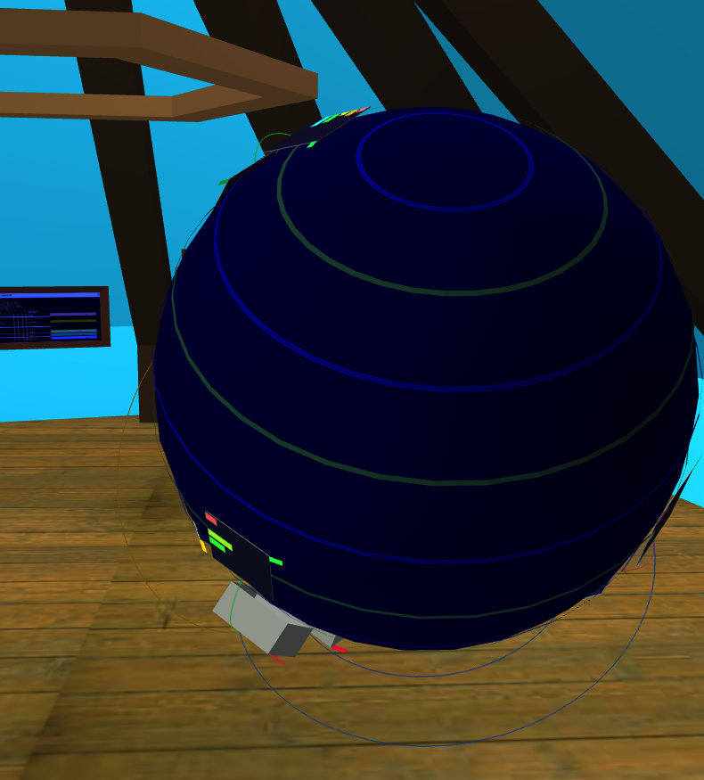
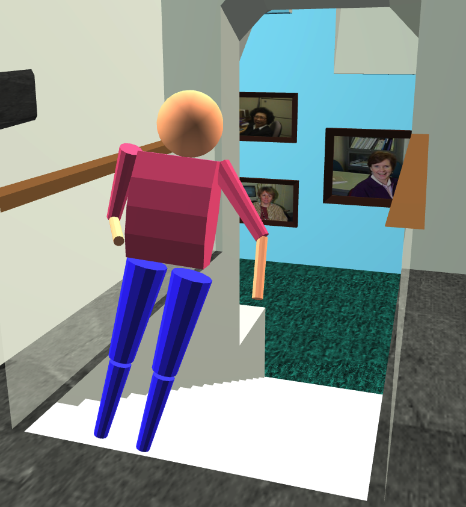
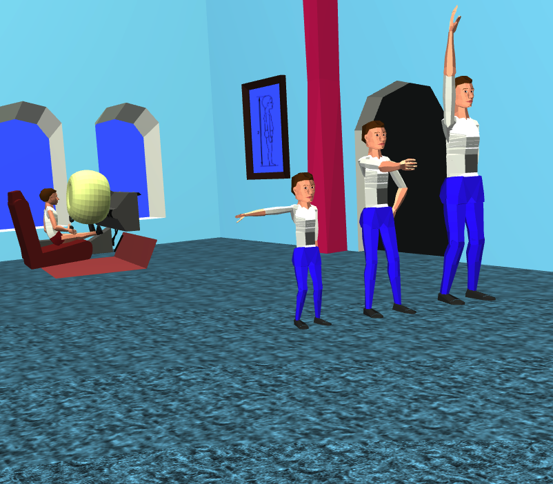
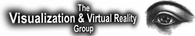

   

<p align="center">
  
</p>

# NIST VVRG Group Demo

A walk-through VRML 2.0 world built around 1998 by the Visualization and Virtual Reality Group (VVRG) at NIST to show off the group's projects. It was never shown outside NIST. This repository is a resurrection of that demo, running in a modern web browser with the [X_ITE](https://create3000.github.io/x_ite/) X3D/VRML player.

## ▶ [RUN ME: launch the live demo](https://sressler.github.io/VVRGGroupDemo/world/xite.html)

Click **Click to enter** when the page loads (this also turns on sound), then walk around.

## What's inside

The building was adapted from the *Virtual Music Museum* and redecorated with the group's work. Its rooms are spread over three floors joined by a working elevator and stairs.


| Room | What to do there |
| --- | --- |
| **Anthropometry (AnthroKids)** | VRML models of children and a child in an air-bag car seat. Click the pictures on the wall to play their videos. |
| **Anthropometric Landmarks of the Head** | A scanned head turning in a glass case, with white dots marking standard measurement landmarks. |
| **Stairs and the falling man** | Click the figure at the top of the steps to send him tumbling down under simulated physics. |
| **WebMetrics** | Displays for the WebVIP, WebCAT and WebSAT web-usability tools. |
| **NIRVE** | A 3D visualization of search results as concept clusters on a sphere. |
| **Robot and miter saw** | Animated machinery models. Click parts of the robot to set them moving. |
| **Credits room** | Photos of the group's members, and a plaque that opens the full credits. |
| **Elevator** | Click the call button, step in, and press a floor button. Each floor has its own announcement. |

## Controls

| Key | Action |
| --- | --- |
| `W` / `↑` | Walk forward |
| `S` / `↓` | Walk backward |
| `A` / `D` | Step left / right |
| `←` / `→` | Turn left / right |
| `Shift` (held) | Move 3× faster |
| `Page Up` / `Page Down` | Previous / next viewpoint |
| `Home` | Return to the first viewpoint |
| Right-click | Viewpoint list, navigation modes, rendering options, full screen |

The header buttons do the same jobs: **Tour**, **◀ View**, **View ▶**, **Reset view**, and **Info panel**, which shows or hides the side panel where links from the world open.

You can also drag a `.wrl`, `.x3dv`, `.x3d`, `.gltf` or `.glb` file onto the page to view it in the same player.

## Run it locally

The world has to be served over HTTP; opening `xite.html` straight from disk will not load it.

```
git clone https://github.com/sressler/VVRGGroupDemo.git
cd VVRGGroupDemo
python3 world/serve.py
```

This serves the `world` folder on port 8086 and opens `http://localhost:8086/xite.html`. Pass a different port as an argument, for example `python3 world/serve.py 8080`.

## Files

| File (in `world/`) | Purpose |
| --- | --- |
| `xite.html` | The X_ITE player page, with keyboard navigation, info panel and drag-and-drop loading |
| `index.wrl` | The main hall, entry point of the world |
| `elevator.wrl`, `hall2.wrl`, `manfall.wrl`, `mitersaw2.wrl`, `workbench.wrl`, … | Inlined worlds and exhibits |
| `help.html` | Help page shown in the info panel |
| `demoCredits.html` | The original 1998 credits page |
| `serve.py` | Local web server |
| `*.orig` | Original VRML files, kept unmodified beside the edited versions |
| `Claude outputs/` | Conversion helpers, including a VRML 1.0 to 2.0 converter |

## Credits

This demo was the result of contributions from virtually all members of the VVRG group. The original geometry of the building came from the Virtual Music Museum, used with their permission, then substantially redecorated and fitted with elevator controls.

**Demo design and implementation:** Sandy Ressler and Brian Antonishek

**VRML objects**

- NIRVE sphere: John Cugini
- Air bag car seat and VRML child: export from Transom Jack
- Robot and miter saw: Qiming Wang
- Chain and falling man: Afzal Godil
- Anthropometric head: Sandy Ressler, Greg Seidman
- Chair in WebMetrics room: 3name3D

**Textures**

- Photographs of group members: Sandy Ressler
- WebMetrics logos: Bill Welsh

**Music and sound effects**

- Elevator music: "Carnival" by Natalie Merchant
- Elevator door: Star Trek: The Next Generation
- Falling man: Homer Simpson
- Chain: Monty Python

Some links inside the world point to old NIST pages that no longer exist.
